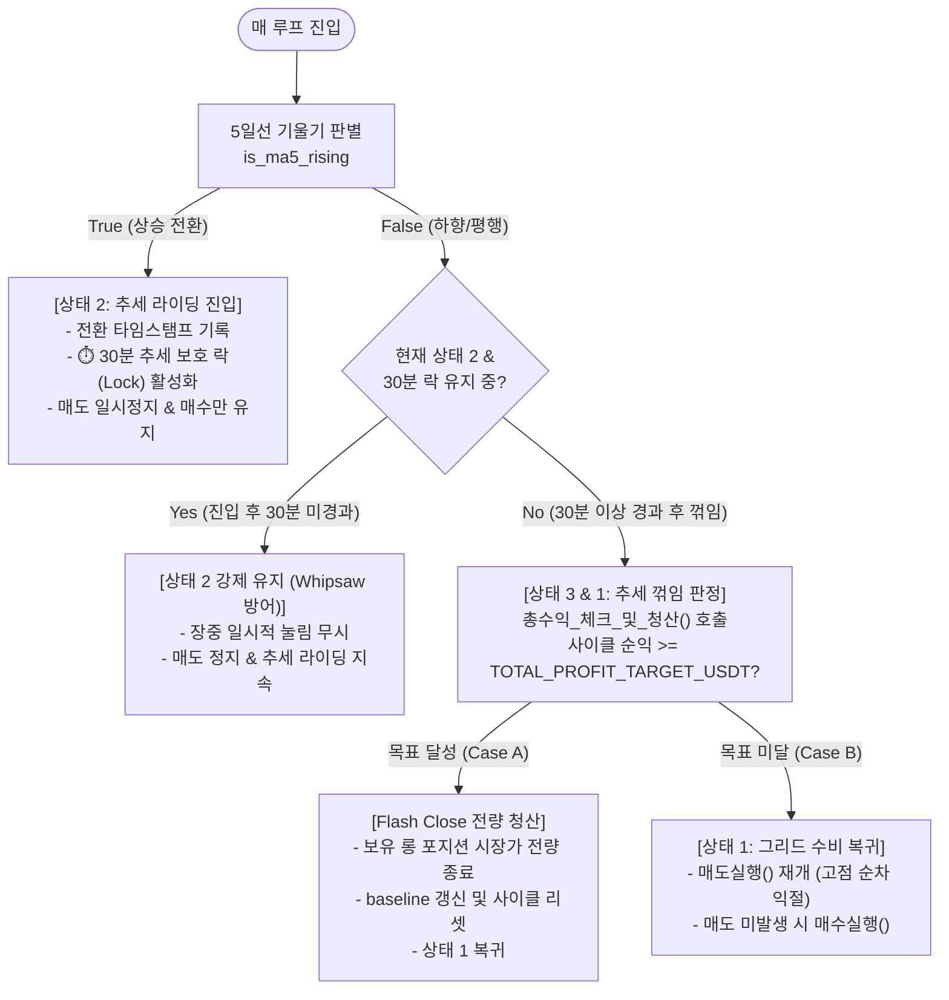

# [구현 계획서] 3-State Switching Engine (30분 완충 버퍼 및 정밀 순익 연동)

## 📌 1. 개요 및 사용자 요구사항 반영

본 계획서는 Bitget 선물 자동매매 봇([`Grid_Bitget.py`](file:///c:/Users/user/Desktop/trading_buddy/06%EB%B9%84%ED%8A%B8%EA%B2%9F%EC%9E%90%EB%8F%99%EB%A7%A4%EB%A7%A4-4%EA%B8%B0/week_01-bitget_grid/Grid_Bitget.py))의 3-State Switching Engine 개편안에 사용자님의 최종 피드백을 완벽히 반영한 최종 구현 가이드입니다.

### 🎯 사용자 핵심 결정 사항
1. **추세 라이딩 완주 (No Premature Exit)**:
   - 상승 중 장중에 목표 금액에 도달하더라도 조기 청산하지 않고, **무조건 5일선이 하향으로 꺾일 때까지 끝까지 라이딩**하여 이익을 극대화합니다.
2. **장중 휩쏘 방지용 30분 상태 유지 완충 버퍼 (30-Minute Trend Lock)**:
   - 5일선 상승(`True`)으로 전환되어 [상태 2: 추세 라이딩]에 진입하면, **최소 30분 동안은 장중 잔파동으로 5일선이 일시 하락하더라도 전략을 스위칭하지 않고 상태 2를 강제 유지**합니다.
   - 30분 경과 후에 비로소 꺾임 신호를 유효하게 수용하여 청산 검사로 전환합니다.
3. **순이익 산출의 정합성 (Excel 원장 + Bitget 실시간 시세 결합)**:
   - 봇에 이미 구현된 `총수익_계산()` 로직은 **엑셀에 기록된 누적 실현손익**과 **비트겟 실시간 현재가 기반 미실현 평가손익**을 합산하여 baseline을 차감하므로, 한 치의 오차 없이 정확한 이번 사이클 순익을 도출합니다.

---

## 🏛 2. 아키텍처 및 30분 완충 버퍼 상태 전이도



---

## 🔍 3. 순이익 계산의 정밀성 검증 (코드 분석)

현재 [`Grid_Bitget.py:L1275-L1292`](file:///c:/Users/user/Desktop/trading_buddy/06%EB%B9%84%ED%8A%B8%EA%B2%9F%EC%9E%90%EB%8F%99%EB%A7%A4%EB%A7%A4-4%EA%B8%B0/week_01-bitget_grid/Grid_Bitget.py#L1275-L1292)에 구현된 계산 공식:

$$\text{사이클 순이익} = (\text{미실현 손익} + \text{누적 실현 손익}) - \text{Baseline}$$

1. **누적 실현 손익 (`누적실현손익_조회`)**:
   - 종목별 엑셀 원장 파일(`BTC-USDT_비트겟그리드_LONG폴.xlsx`)의 마지막 거래 행에 기록된 정확한 누적 실현손익을 추출합니다. (과거 확정된 실제 현금 수익)
2. **미실현 손익 (`미실현손익조회_엑셀` / `미실현손익조회_거래소`)**:
   - 엑셀에 기록된 현재 열려있는 미청산 차수들의 `매수가`, `매수수량`, `매수금액`과 비트겟에서 실시간으로 받아온 `현재가`를 대입하여 수수료까지 반영한 정확한 미실현 평가손익을 산출합니다. (설정에 따라 비트겟 API의 `fetch_positions`를 직접 참조 가능)
3. **Baseline (사이클 기준점)**:
   - 직전 사이클 청산 시점의 누적 실현익이 파일(`.SOXL_..._baseline.json`)에 영구 저장되어 있습니다.
4. **결론**:
   - **엑셀의 완벽한 포지션 원장 기록**과 **비트겟의 실시간 시세 정보**가 유기적으로 합산되므로, 이번 사이클 동안 순수하게 창출된 총 순이익(실현 + 미실현)이 1원 단위까지 정밀하게 집계됩니다.

---

## 🛠 4. 소스 코드 상세 수정 계획 (`Grid_Bitget.py`)

### 1단계: 설정 상수 추가 (~335행)
```python
# 📌 3-State Switching Engine 설정
TREND_RIDING_ENABLE = True          # 3-State 스위칭 엔진 On/Off
TREND_MIN_HOLD_SECONDS = 1800       # 상태 2 진입 후 최소 유지 시간 (30분 = 1800초, 휩쏘 방지)
MA_TIMEFRAME = "1d"                 # 이동평균 기준 일봉 (1D)
MA_PERIOD = 5                       # 5일 이동평균선
MA_CACHE_SECONDS = 30               # 일봉 API 호출 캐시 주기 (초)
```

### 2단계: 5일선 기울기 헬퍼 함수 (`is_ma5_rising`) 구현 (~1520행)
- `bitgetX.fetch_ohlcv(Ticker, timeframe="1d", limit=6)` 호출 (30초 캐싱)
- `MA5_yesterday` = 과거 5일 종가 평균 (`ohlcv[-6:-1]`)
- `MA5_today` = 오늘 진행 중 봉 포함 5일 종가 평균 (`ohlcv[-5:]`)
- `is_rising = MA5_today > MA5_yesterday` 불리언 반환

### 3단계: 30분 완충 버퍼 상태 관리자 구현
```python
_trend_state = {
    # Ticker: {"is_riding": False, "entered_at": 0.0}
}

def 추세라이딩_상태체크(Ticker: str) -> bool:
    """
    30분 완충 버퍼가 적용된 추세 라이딩(상태 2) 활성 여부 반환
    - 5일선 상승 시 상태 2 진입 및 진입 시각 기록
    - 상태 2 진입 후 30분 동안은 장중 5일선이 일시 하락해도 상태 2 강제 유지 (Whipsaw 방어)
    - 30분 경과 후 5일선이 하향이면 비로소 상태 2 종료 (False 반환 -> 청산 검사 진입)
    """
    now = time.time()
    state = _trend_state.setdefault(Ticker, {"is_riding": False, "entered_at": 0.0})
    rising = is_ma5_rising(Ticker)

    if not state["is_riding"]:
        if rising:
            state["is_riding"] = True
            state["entered_at"] = now
            print(f"🚀 [{Ticker}] 5일선 상승 전환 -> 상태 2 [추세 라이딩] 진입 (30분 보호 락 활성화)")
            # 텔레그램 안내 발송
            return True
        return False
    else:
        # 이미 상태 2인 경우: 30분 미경과 시 5일선과 무관하게 상태 2 유지
        elapsed = now - state["entered_at"]
        if elapsed < TREND_MIN_HOLD_SECONDS:
            return True  # 30분 보호 락 유지 중
        
        # 30분 경과 후: 5일선이 여전히 상승 중이면 라이딩 지속, 하향이면 상태 2 종료
        if rising:
            return True
        else:
            state["is_riding"] = False
            state["entered_at"] = 0.0
            print(f"📉 [{Ticker}] 30분 경과 후 5일선 하향 꺾임 감지 -> 추세 라이딩 종료 (청산 검사 진입)")
            return False
```

### 4단계: 메인 루프 (`main_loop`) 스위칭 통합 (~2350행)
```python
# --- 메인 루프 내 종목별 처리 구역 ---
라이딩_중 = 추세라이딩_상태체크(Ticker) if TREND_RIDING_ENABLE else False

if 라이딩_중:
    # ── 상태 2: [추세 라이딩] 매도 스탑 (100% 홀딩) & 매수만 유지 ──
    매수실행(Ticker, 현재가)
else:
    # ── 상태 3 & 1: [추세 꺾임 / 그리드 수비] ──
    # 1) 5일선 꺾인 시점에서 총수익 목표 달성 여부 검사
    if TOTAL_PROFIT_TARGET_ENABLE:
        청산_발생 = 총수익_체크_및_청산(Ticker, 현재가)
        if 청산_발생:
            continue  # 전량 청산 완료 -> 이번 폴링 종료 (다음 사이클 준비)

    # 2) 목표 미달 시 멈췄던 그리드 매도 재개 -> 고점 순차 익절
    매도발생 = 매도실행(Ticker, 현재가)
    if not 매도발생:
        매수실행(Ticker, 현재가)
```

### 5단계: 잔고/증거금 부족 무중단 예외 처리 (`매수실행`, ~1640행)
- `ccxt.InsufficientFunds` 및 증거금 부족 메시지 캡처 시:
  - 봇 메인 루프 백오프 슬립 방지
  - 해당 매수 시도만 안전 스킵(`return`)
  - **감시 루프 및 5일선 추적, 포지션 평가, 꺾임 청산은 100% 정상 작동 유지**

---

## 🧪 5. 검증 계획

1. **정적 문법 검증**: `python -m py_compile Grid_Bitget.py` (Exit code: 0)
2. **30분 완충 버퍼 로직 단위 테스트**:
   - `entered_at` 기준 10분, 20분 시점에 `rising=False`가 들어와도 라이딩이 유지되는지 검증
   - 31분 시점에 `rising=False` 발생 시 정상적으로 청산 검사로 넘어가는지 검증
3. **모의 잔고 부족 에러 주입 테스트**:
   - 잔고 부족 예외 발생 시 메인 루프 딜레이 없이 3초 주기로 청산 루프가 도는지 검증

---

## 🚦 6. 다음 단계 안내

본 계획서는 `/ask` 정책에 따라 **코드 수정 없이 작성된 계획서**입니다.  
내용을 확인하시고 코드 수정을 원하시면 말씀해 주세요!

- **실행 명령어**: `/apply` 또는 **"반영해줘"**
