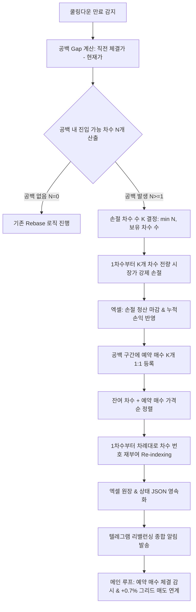

# 📋 [구현 계획서] 쿨링다운 공백 복원 롤다운 그리드 전략 (옵션 B - 무제한 공백 복원)

---

## 1. 개요 및 배경

### 1.1 배경 및 목적
- **현상**: 급락장 발생 시 단시간 내 다수 차수가 체결되어 `매수 쿨링다운(Buy Cooldown)`이 발동되고, 쿨링 동안 시세가 추가 급락하면 마지막 체결 차수와 쿨링 해제 현재가 사이에 **거대한 가격 공백(Gap)**이 발생합니다.
- **문제점**: 공백 구간에 매수된 재고가 없으므로, 시세가 해당 구간에서 횡보하더라도 0.7~1.0 USDT의 그리드 익절을 전혀 발생시키지 못하며, 상위 1차수 등은 장기간 물린 상태로 방치되어 자본 기회비용이 극심해집니다.
- **해결책 (옵션 B - 완전 복원)**:
  1. 쿨링 해제 시점에 발생한 공백을 채울 수 있는 차수 개수($N$)를 산출합니다.
  2. 공백 크기만큼 **보유 중인 상위 차수(1차수부터 순차적으로)를 제약 없이 전액 시장가 강제 손절(`reduceOnly=True`)**하여 자금과 슬롯을 확보합니다. (최대 보유 차수 한도 내에서 $K = \min(N, \text{보유 차수 수})$ 만큼 손절)
  3. 손절된 차수는 엑셀에 `손절 청산 완료`로 마감 처리하고, 손실액은 누적 실현손익에 즉시 반영합니다.
  4. 비어있는 공백 가격대에 **예약 매수(Trigger Order)**를 1:1로 등록합니다.
  5. 잔여 미청산 차수들과 예약 매수 차수들을 **높은 가격부터 내림차순 정렬하여 1차수, 2차수, 3차수... 순으로 번호를 완전 재배치(Re-indexing)**합니다.

---

## 2. 전체 동작 프로세스 및 플로우차트



---

## 3. 구체적인 동작 시뮬레이션 (Before & After)

### 📊 예시 시나리오
- 그리드 간격: `0.7%` ($0.7 단위 가정)
- 쿨링 진입 전 보유: 1차($100), 2차($99), 3차($98), 4차($97), 5차($96)
- 쿨링 동안 급락하여 해제 시 현재가: **$93.0**
- 공백 구간: $95.3, $94.6, $93.9, $93.2 (총 4개 차수 분량의 공백 발생)
- **손절 개수 결정**: $K = \min(4, 5) = 4$개 (1차, 2차, 3차, 4차 전원 손절)

### 🔄 상태 변화 (Before ➔ After)

| 구분 | 단계 1: 쿨링 해제 직전 | 단계 2: 강제 손절 실행 | 단계 3: 예약 매수 등록 및 차수 재배치 (최종) |
| :--- | :--- | :--- | :--- |
| **1차수** | $100.0 (미청산) | **$93.0에 손절 마감** (`-$7.0`) | **$96.0** (기존 5차수가 1차수로 승계) |
| **2차수** | $99.0 (미청산) | **$93.0에 손절 마감** (`-$6.0`) | **$95.3** (신규 공백 예약 매수 ①) |
| **3차수** | $98.0 (미청산) | **$93.0에 손절 마감** (`-$5.0`) | **$94.6** (신규 공백 예약 매수 ②) |
| **4차수** | $97.0 (미청산) | **$93.0에 손절 마감** (`-$4.0`) | **$93.9** (신규 공백 예약 매수 ③) |
| **5차수** | $96.0 (미청산) | 유지 | **$93.2** (신규 공백 예약 매수 ④) |
| **공백 구간** | $93.0 ~ $96.0 (텅 빔) | 손절 자금 회수 완료 | **그리드 그물망 100% 완전 복원 완료** |

---

## 4. 모듈별 구현 세부 설계

### 4.1 신규 설정값 정의 (`Grid_Bitget.py`)
```python
# --- 쿨링 공백 복원 롤다운 설정 (옵션 B) ---
GAP_RECONSTRUCTION_ENABLE = True       # 공백 복원 롤다운 활성화 여부
# 사용자 요청 반영: 최소 유지 차수 및 1회 최대 손절 차수 제한 없이 공백에 맞춰 100% 완전 복원
```

### 4.2 공백 계산 및 강제 손절 함수 (`쿨링_공백복원_실행`)
- **위치**: [Grid_Bitget.py](file:///c:/Users/user/Desktop/trading_buddy/06비트겟자동매매-4기/week_01-bitget_grid/Grid_Bitget.py)
- **로직**:
  1. 쿨링 해제 시점 미청산 목록 중 가장 낮은 매수가(최하위 차수) $P_{min}$과 현재가 $P_{curr}$ 비교.
  2. $Gap = (P_{min} - P_{curr}) / P_{min} \times 100$ (%) 계산.
  3. 공백 차수 수 $N = \lfloor Gap / |매수간격| \rfloor$.
  4. 손절 차수 수 $K = \min(N, \text{미청산 차수 총 개수})$. (인위적 캡 없이 공백 크기만큼 전량 손절)
  5. 1차수부터 $K$개 차수를 `bitgetX.create_market_sell_order(amount, params={'reduceOnly': True})` 실행.
  6. 체결가 기준 실현손익 계산 및 엑셀에 `매도날짜=지금()`, `매도가=체결가`, `비고=손절 청산 완료` 처리.

### 4.3 차수 번호 재배치 알고리즘 (`엑셀_차수_재배치`)
- **원칙**: 남아있는 미청산 차수들과 공백 예약 매수 차수들을 **`매수가(또는 목표예약가)` 내림차순(높은 가격부터)** 정렬.
- **재부여**:
  ```python
  # 정렬: 기존 보유분은 '매수가' 기준, 예약 매수는 '예약목표가' 기준 내림차순
  combined_orders = sorted(active_positions + pending_limit_orders, key=lambda x: x['가격'], reverse=True)
  for new_차수, item in enumerate(combined_orders, start=1):
      item['차수'] = new_차수
  ```
- 엑셀의 미청산 행들의 `차수` 값을 새로운 1, 2, 3... 번호로 업데이트하여 저장.

### 4.4 예약 매수 주문 관리 및 상태 추적
- **비트겟 Trigger Order (스탑/예약 매수) 또는 봇 Polling 감시**:
  - 현재가보다 높은 공백 가격에 도달 시 시장가로 체결되도록 Plan Order API 호출.
  - 상태 파일(`.{Ticker}_gap_pending_orders.json`)을 생성하여 봇 재시작 시에도 예약 매수 상태 완벽 복구.

### 4.5 예약 매수 체결 후 그리드 매도 연계
- 예약 매수가 체결되는 즉시:
  1. 엑셀에 해당 차수의 `매수날짜`, `매수가`, `매수수량` 정식 기록.
  2. 기존 그리드 매도 감시 루프에 자동 편입되어 `체결가 × (1 + 매도간격%)` 도달 시 또는 트레일링 매도 조건 충족 시 익절 청산 진행.

---

## 5. 검증 계획

1. **단위 정렬 알고리즘 검증 (Unit Test)**:
   - 더미 데이터(보유 차수 다수 손절 후 예약 매수와 결합)를 생성하여 높은 가격순으로 1~5차수가 정확하게 재배치되는지 스크립트로 검증.
2. **엑셀 원장 정합성 검증**:
   - 손절 처리된 행들의 실현손익이 엑셀 하단의 `누적실현손익`에 정상 누적 합산되는지 확인.
3. **터미널 구문 검사**:
   - `python -m py_compile Grid_Bitget.py` 명령으로 문법 오류 없음 검증.

---

> [!NOTE]
> 본 계획서는 `/ask` 정책에 따라 소스 코드를 변경하지 않고 설계만 완료된 상태입니다.
> 사용자분의 검토 후 **`/apply`** 명령을 주시면 위 계획에 따라 실제 코드 구현을 진행합니다.
