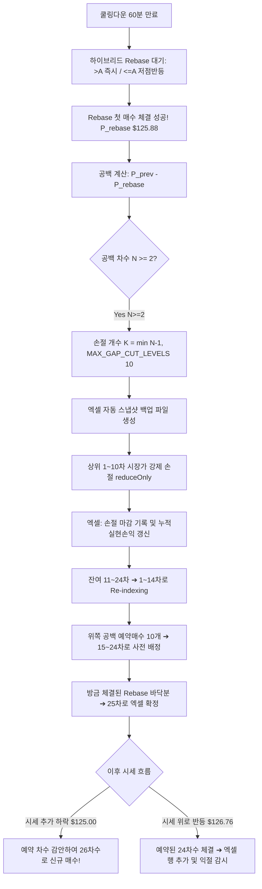

# 📋 [구현 계획서] 쿨링 공백 복원 롤다운 그리드 전략 (실전 완성형 v2.1)

---

## 1. 개요 및 사용자 피드백 반영 핵심 원칙

현재 **24차수(진입금액 약 3,415 USDT)**가 실제 운용 중인 환경을 고려하여, 가격 순서와 차수 번호의 일관성을 100% 보장하는 최종 설계도입니다.

### 🎯 핵심 설계 변경 (사용자 피드백 100% 반영)
1. **공백 계산 기준 시점**:
   - 쿨링 만료 순간이 아닌, **"쿨링 만료 후 하이브리드 Rebase 로직에 의해 첫 번째 재매수가 실제로 성공 체결된 시점"**의 체결가를 기준으로 공백을 계산합니다.
2. **손절 캡(10개) 적용 시 공백 배치 위치**:
   - 10개의 예약 매수 그물은 **"이번에 체결된 바닥 매수가 바로 위부터 촘촘하게 10개"**를 우선 배치합니다 (`MAX_GAP_CUT_LEVELS = 10`).
3. **추가 하락 시 차수 연속성 (가격 내림차순 엄격 일치) ⭐**:
   - 그리드 대원칙: **"차수 번호가 클수록 더 낮은 가격이다."**
   - 가격 순서에 따라 차수 번호를 완벽히 정렬하여, 위로 반등하든 아래로 추가 하락하든 번호 충돌이 전혀 발생하지 않도록 설계합니다.

---

## 2. 완벽한 차수 번호 체계 (가격 내림차순 정렬 규칙, 10개 캡 기준) ⭐

> **[상황 가정]**
> * 쿨링 전 1~24차 보유 (최하위 24차: $140.83)
> * 쿨링 해제 후 Rebase 첫 매수 체결 성공: **$125.88** (공백 발생 ➔ 상위 1~10차 손절 마감, $K=10$)

### 📊 가격순에 따른 차수 번호 부여표 (수학적 1:1 완벽 정합)

| 차수 번호 | 가격대 | 성격 | 비고 |
| :---: | :---: | :---: | :--- |
| **1차 ~ 14차** | $140.83 이상 | 기존 보유분 (구 11~24차, 총 14개) | 상위 1~10차 손절 후 남은 최고가 물량 |
| **15차 ~ 24차** | $126.76 ~ $134.69 | **공백 예약 매수 (10개)** | 바닥 바로 위 공백 구간에 걸어둔 대기 그물망 |
| **25차** | **$125.88** | **방금 체결된 Rebase 바닥분** | 현재 실제 보유 중인 최하위 포지션 |
| **26차** | **$125.00** | **추가 하락 시 신규 매수분** | **예약 차수를 완벽히 감안하여 26차로 신규 진입!** |

---

## 3. 세부 동작 프로세스 플로우

---

## 4. 이후 시나리오별 동작 검증

### 시나리오 A: 시세가 반등하지 않고 아래로 더 떨어질 때 (사용자 질문)
* 현재 보유 최하위 차수는 **25차수 ($125.88)**입니다.
* 시세가 -0.7% 추가 하락하여 $125.00에 도달하면:
  * 봇은 예약 차수(15~24차)를 이미 인지하고 있으므로, 그 다음 번호인 **`26차수`**로 신규 매수합니다.
  * 엑셀에는 `차수: 26, 매수가: $125.00` 행이 추가됩니다.
  * ➔ **결과**: 위쪽 예약 매수 번호와 일체의 겹침/충돌 없이 완벽한 연속성이 유지됩니다.

### 시나리오 B: 시세가 바닥에서 위로 반등할 때
* 시세가 $125.88에서 $126.76으로 올라오면:
  * 예약 매수 중 가장 가까운 **`24차수`**가 체결되어 엑셀에 추가됩니다.
* 추가로 $127.64로 올라오면:
  * 예약 매수 **`23차수`**가 체결됩니다.
* ➔ **결과**: 24차, 23차, 22차가 차례대로 체결되며 각각 `+0.7%` 익절 감시 루프에 자동 편입됩니다.

---

## 5. 안전장치 및 검증 계획

1. **엑셀 원장 스냅샷 자동 백업**:
   * 파일명: `{Ticker}_LONG폴_backup_{YYYYMMDD_HHMMSS}.xlsx`
2. **지갑 증거금 체크**:
   * 손절 후 가용 증거금이 예약 매수를 소화하기에 충분한지 사전 검사.
3. **터미널 구문 검사**:
   * `python -m py_compile Grid_Bitget.py` 검증 수행.
