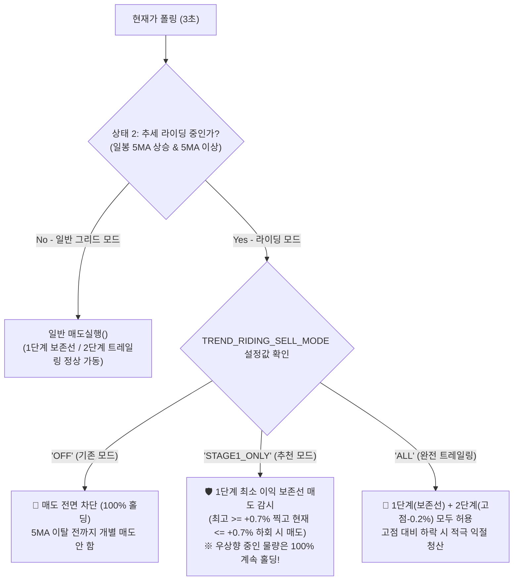

# 📋 [구현 계획서] 추세 라이딩 중 최소 이익 보존선(0.7%) 하향 매도 & 모드 스위치 동시 구축
> **상승 추세 라이딩(100% 홀딩)의 수익 극대화 + 이익 반납 방지 0.7% 락인 안전망의 완벽한 결합**

---

## 1. 배경 및 사용자 요구사항 분석

### 🚨 핵심 문제 의식
> **"방안 1과 방안 3을 동시에 구현할 수도 있는 거 아니야?"**
> - **방안 1 (이익 보존 매도)**: 추세 라이딩 중이라도, 이미 +0.7% 이상 올랐던 차수가 반락하여 **최소 이익 보존선(+0.7%)을 하향 이탈할 때는 매도하여 이익을 확정 보존**해야 함.
> - **방안 3 (설정 스위치화)**: 사용자 성향과 시장 상황에 따라 **기존의 100% 무조건 홀딩 모드 vs 0.7% 보존선 매도 모드**를 상단 설정값 하나로 언제든지 자유롭게 선택할 수 있어야 함.

👉 **결론**: 두 방안은 대립하는 것이 아니라, **"방안 1의 이익 보존 매도 기능"을 핵심 엔진으로 구현하고, 이를 "방안 3의 직관적인 상단 모드 스위치"로 제어**하도록 결합하는 것이 가장 완벽하고 전문적인 설계입니다.

---

## 2. 3-State 추세 라이딩 매도 제어 아키텍처



---

## 3. 핵심 설계 명세

### 1) 상단 모드 스위치 파라미터 신설 (`Grid_Bitget.py`)
```python
# ==============================================================================
# 📌 추세 라이딩(상태 2) 중 매도 제어 모드 스위치
# ==============================================================================
# - "STAGE1_ONLY" (권장): 
#     우상향 중인 차수는 100% 홀딩하여 추세를 끝까지 타되,
#     수익률이 +0.7% 이상 도달 후 0.7% 이하로 반락하는 차수만 '이익 보존 매도'를 실행하여 이익 반납 원천 차단.
# - "ALL":
#     1단계(0.7% 보존선) 및 2단계(0.9% 이상 도달 후 고점 대비 -0.2%p 하락) 모두 매도 허용.
# - "OFF":
#     기존 방식 (5MA 지지선 이탈 전까지 매도 100% 전면 금지 및 무조건 홀딩).
TREND_RIDING_SELL_MODE = "STAGE1_ONLY"  # "STAGE1_ONLY" | "ALL" | "OFF"
```

### 2) `매도실행()` 함수의 `riding_mode` 파라미터 확장
현재 [`매도실행(Ticker, 현재가)`](file:///c:/Users/user/Desktop/trading_buddy/06비트겟자동매매-4기/week_01-bitget_grid/Grid_Bitget.py#L3338) 함수에 `riding_mode: Optional[str] = None` 파라미터를 추가하여 라이딩 중의 매도 조건을 정밀 분기합니다:

```python
def 매도실행(Ticker: str, 현재가: float, riding_mode: Optional[str] = None) -> bool:
    ...
    # 고점 갱신 (추세 라이딩 중에도 최고수익률을 실시간 갱신하여 엑셀 영속성 보존)
    최고수익률 = max(기존고점, 현재수익률)
    if 최고수익률 != 기존고점:
        df.at[idx, "최고수익률"] = round(최고수익률, 4)
        고점갱신됨 = True

    매도조건 = False
    트레일매도선 = 0.0
    트레일단계 = 0

    if TRAILING_ENABLE:
        if 최고수익률 >= TRAIL_STAGE2_PCT:
            트레일단계 = 2
            트레일매도선 = 최고수익률 - TRAIL_DISTANCE_PCT
            # riding_mode가 "STAGE1_ONLY"인 경우 2단계 다이내믹 트레일링(고점 -0.2%)은 홀딩!
            # 단, 가격이 계속 내려와서 1단계 보존선(+0.7%)마저 깰 때는 매도 발동!
            if riding_mode == "STAGE1_ONLY":
                매도조건 = (현재수익률 <= TRAIL_STAGE1_PCT)
            else:
                매도조건 = (현재수익률 <= 트레일매도선)

        elif 최고수익률 >= TRAIL_STAGE1_PCT:
            트레일단계 = 1
            트레일매도선 = TRAIL_STAGE1_PCT
            매도조건 = (현재수익률 <= 트레일매도선)
    ...
```

### 3) `main_loop()` 스위칭 연동
[`main_loop()`](file:///c:/Users/user/Desktop/trading_buddy/06비트겟자동매매-4기/week_01-bitget_grid/Grid_Bitget.py#L4427)의 추세 라이딩 분기에서 `TREND_RIDING_SELL_MODE` 설정값에 따라 정밀 제어:

```python
if 라이딩_중:
    매도발생 = False
    if TREND_RIDING_SELL_MODE in ("STAGE1_ONLY", "ALL"):
        # ── 상태 2: [추세 라이딩 중 부분 방어 매도 허용] ──
        매도발생 = 매도실행(Ticker, 현재가, riding_mode=TREND_RIDING_SELL_MODE)
        더미_가상매도_감시_및_실행(Ticker, 현재가)
    
    # 매도가 발생하지 않은 경우에만 하단 그리드 매수 유지 (포지션 방어)
    if not 매도발생:
        매수실행(Ticker, 현재가)
else:
    # ── 상태 3 및 상태 1: [추세 꺾임 / 그리드 수비 모드] ──
    ...
```

### 4) 텔레그램 청산 완료 메시지 태그 고도화
추세 라이딩 중에 이익 보존 매도가 체결되었을 경우, 알림 메시지에 다음과 같이 상태를 명확히 안내:
- `📍 트레일링(1차-라이딩보존): 고점 1.2500% / 보존선 0.7000% / 청산시 0.6950%`
- 사용자가 메시지를 보고 **"아, 추세 라이딩 중이었지만 이익이 0.7% 아래로 날아가는 것을 방어하기 위해 안전하게 익절했구나!"**를 즉시 확인 가능.

---

## 4. 기대 효과 및 장점

1. **완벽한 하방 방어 (Downside Protection)**:
   - 일봉 5MA 지지선 이탈까지 기다리지 않고, 개별 차수 차원에서 +0.7% 최소 수익을 확실하게 잠금(Lock-in).
2. **상승 추세 모멘텀 보존 (Upside Potential)**:
   - +0.7%를 넘어 계속해서 고점을 높이며 치고 올라가는 차수는 매도되지 않고 100% 홀딩되어, 총수익 목표(150 USDT) 달성 시 전량 Flash Close 가능.
3. **사용자 제어권 극대화 (Flexibility)**:
   - 상단 설정값(`TREND_RIDING_SELL_MODE = "STAGE1_ONLY" | "ALL" | "OFF"`) 하나로 언제든지 전략 성향(보수적 익절 vs 공격적 홀딩) 변경 가능.

---

## 5. 단계별 검증 절차

1. **단위 논리 시뮬레이션 검증**:
   - `최고수익률 = 1.3%`, `현재수익률 = 1.1%` (고점 대비 -0.2%) 상황:
     - `STAGE1_ONLY`: 매도 미발생 (홀딩 유지)
     - `ALL`: 매도 발생 (2단계 청산)
   - `최고수익률 = 1.3%`, `현재수익률 = 0.68%` (0.7% 하회) 상황:
     - `STAGE1_ONLY`: **매도 발생 (0.7% 보존 청산)**
     - `OFF`: 매도 미발생 (기존 무조건 홀딩)
2. **정적 구문 컴파일 검증**:
   - `python -m py_compile Grid_Bitget.py` 명령으로 에러 0건 확인.
3. **봇 시작 알림 및 콘솔 배너 정합성 검증**:
   - 기동 시 텔레그램 시작 메시지에 `TREND_RIDING_SELL_MODE` 설정 상태 표기 확인.

---

## 6. 다음 진행 안내 (`/apply`)

> [!NOTE]
> 본 계획서는 `/ask` 모드 정책(Rule 5)에 따라 **프로젝트 소스 코드를 수정하지 않고 계획서만 작성**되었습니다.
> 위 구현 계획대로 실제 소스 코드([`Grid_Bitget.py`](file:///c:/Users/user/Desktop/trading_buddy/06비트겟자동매매-4기/week_01-bitget_grid/Grid_Bitget.py))에 반영을 진행하시려면 **`/apply`** 명령어를 입력해 주시기 바랍니다.
