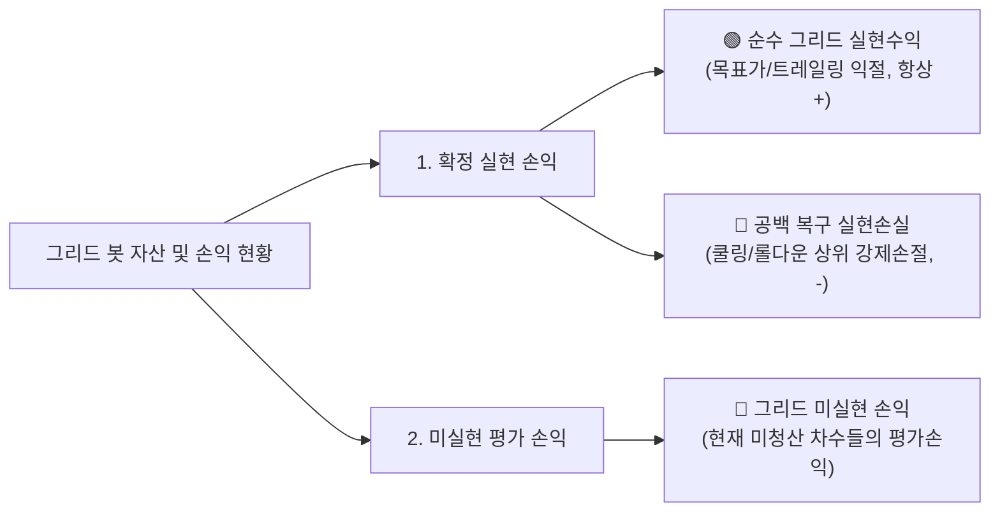

# 📋 [구현 계획서] 일일 정산 텔레그램 메시지 3대 손익 지표 분리 체계 구축
> **순수 그리드 실현수익 🟢 vs 공백 복구 실현손실 🔴 vs 현재 포지션 미실현 손익 🧊 완전 분리**

---

## 1. 배경 및 사용자 피드백 핵심 분석

### 🚨 사용자의 날카로운 문제 제기
> **"일일 정산 텔레그램 메세지에서 순수한 그리드매도를 통한 수익금 정보(일간, 주간, 월간), 쿨링다운 후 공백 복구 전략으로 인한 실현손실금 정보, 그리드 매수 이후의 미실현 손실금 정보에 대한 정보가 분리되어야 할 것 같아. 그리드매매의 특성 상 그리드매매만을 통한 수익이 -될 수는 없잖아."**

### 📊 실제 데이터 전수 분석 결과 (`SOXL-USDT_비트겟그리드_LONG폴.xlsx`)
봇이 가동된 전체 기간 동안의 청산 기록 353건을 전수 검증한 결과는 다음과 같습니다:

| 구분 | 체결 건수 | 실현손익 합계 (USDT) | 건당 평균 손익 (USDT) | 성격 및 발생 원인 |
| :--- | :---: | :---: | :---: | :--- |
| **🟢 순수 그리드 익절** | **333건** | **`+340.3855 USDT`** | **`+1.0222 USDT`** | 하락 시 분할 매수 후 목표가(+0.7% 또는 트레일링) 도달로 익절 청산된 순수 그리드 수익 |
| **🔴 공백 복구 손절** | **20건** | **`-619.3499 USDT`** | **`-30.9675 USDT`** | 급락 구간에서 바닥 Rebase 및 자가치유 롤다운을 위해 상위 차수를 시장가 강제 손절한 비용 |
| **⚖️ 종합 순실현손익** | **353건** | **`-278.9644 USDT`** | - | 두 지표를 무차별 합산하여 마이너스로 표기됨 |

#### 기존 일일 정산 메시지의 심각한 착시 현상:
- 2026-10-14: 매도 52건 전부 순수 그리드 매도 ➔ **`+48.6455 USDT`** (손절 0건)
- 2026-10-15: 매도 36건 중 그리드 익절 25건(`+22.37 USDT`), 공백 손절 11건(`-499.63 USDT`) ➔ 기존 메시지는 **`실현수익 -477.2621 USDT`**로 단순 표기!
- 2026-10-13: 매도 24건 중 그리드 익절 21건(`+18.92 USDT`), 공백 손절 3건(`-101.32 USDT`) ➔ 기존 메시지는 **`실현수익 -82.3986 USDT`**로 단순 표기!

👉 **결과**: 사용자가 볼 때 **"그리드봇이 하루에 477달러나 잃고 있나?"**라는 엄청난 오해를 불러일으킴.  
실제로는 **그리드 매매 자체는 매일 꾸준히 +20~50달러씩 착실하게 수익**을 쌓고 있었고, 마이너스의 원인은 **급락 구간에서 롤다운을 단행하며 지불한 일회성 공백 손절 비용**이었습니다.

---

## 2. 3대 핵심 손익 분리 정의



### 1) 🟢 순수 그리드 실현수익 (Pure Grid Profit)
- **대상**: 목표가 익절(+0.7%) 또는 트레일링 매도로 청산된 정상 그리드 주문.
- **특징**: 그리드 매매의 본질적 수익으로 **절대로 마이너스가 될 수 없음(항상 `+`)**.
- **제공 지표**:
  - 일간(1일전, 2일전, 3일전), 주간(최근 7일), 월간(최근 30일), 전체 누적
  - 익절 건수, 총 실현수익, 매도 1회 평균 수익, (주간/월간/전체의 경우) 일일 평균 수익

### 2) 🔴 쿨링다운 후 공백 복구 실현손실 (Gap Recovery Stop-Loss)
- **대상**: 급락 시 쿨링다운 종료 후 하이브리드 Rebase 또는 비상 롤다운을 위해 상위 차수를 시장가 강제 매도(손절)한 주문.
- **특징**: 급락 장에서 봇의 고립을 방지하고 바닥에서 그물을 재배치하기 위해 발생한 **전략적 리밸런싱 비용**.
- **제공 지표**:
  - 일간(1일전, 2일전, 3일전), 주간, 월간, 전체 누적
  - 손절 건수, 총 실현손실(USDT). 손절이 없었던 날은 `0.0000 USDT (0건)` 명시.

### 3) 🧊 그리드 미실현 손익 (Open Positions Unrealized PnL)
- **대상**: 현재 매수 체결되어 미청산 상태로 유지 중인 모든 그리드 차수 포지션.
- **특징**: 진입 평단가 대비 현재 시장가 평가에 따른 미실현 손익(Unrealized PnL).
- **제공 지표**:
  - 미청산 보유 차수 개수, 총 투입금액(USDT)
  - 미실현 평가손익(USDT) 및 수익률(ROE %)
  - 진입 평단가 vs 현재 시장가

---

## 3. 텔레그램 메시지 개편안 (Before vs After)

### ❌ 기존 메시지 (구분 없이 합산되어 왜곡 발생)
```text
1️⃣ [일일 정산]
📌 SOXL
  매수 42건 | 수량 49.49 | 5,981.22 USDT
  매도 36건 | 수량 38.42 | 4,651.42 USDT
  [1일전(2026-10-15)] 실현수익 -477.2621 USDT | 매도 1회 평균: -13.2573 USDT | 수수료 2.8680 USDT
  [2일전(2026-10-14)] 실현수익 +48.6455 USDT | 매도 1회 평균: +0.9355 USDT | 수수료 5.9643 USDT
  [3일전(2026-10-13)] 실현수익 -82.3986 USDT | 매도 1회 평균: -3.4333 USDT | 수수료 2.4057 USDT

2️⃣ [주간 정산] (최근 7일 / 거래 7일)
📌 SOXL
  매수 218건 | 수량 245.20 | 28,140.50 USDT
  매도 195건 | 수량 210.15 | 24,950.20 USDT
  실현수익 -403.9299 USDT (매도 1회 평균: -2.0714 USDT | 일일 수익 평균: -57.7043 USDT (7일 기준) | 수수료 24.1205 USDT)
```

---

### ✅ 개선 메시지 (3대 지표 완벽 분리 및 직관적 시각화)
```text
🏁 *[비트겟 그리드봇 종합 정산 (SOXL)]*
📅 2026-10-17 (KST 9시 기준)
━━━━━━━━━━━━━━━
1️⃣ [일일 정산]
📌 SOXL
  매수 42건 | 수량 49.49 | 5,981.22 USDT
  매도 36건 | 수량 38.42 | 4,651.42 USDT
  [1일전(2026-10-15)] 순실현 -477.2621 USDT (수수료 2.8680 USDT)
    • 🟢 순수 그리드 익절: +22.3673 USDT (25건 | 건당 +0.8947 USDT)
    • 🔴 공백복원 손절:   -499.6294 USDT (11건)
  [2일전(2026-10-14)] 순실현 +48.6455 USDT (수수료 5.9643 USDT)
    • 🟢 순수 그리드 익절: +48.6455 USDT (52건 | 건당 +0.9355 USDT)
    • ⚪ 공백복원 손절:   0.0000 USDT (0건)
  [3일전(2026-10-13)] 순실현 -82.3986 USDT (수수료 2.4057 USDT)
    • 🟢 순수 그리드 익절: +18.9187 USDT (21건 | 건당 +0.9009 USDT)
    • 🔴 공백복원 손절:   -101.3173 USDT (3건)
━━━━━━━━━━━━━━━
2️⃣ [주간 정산] (최근 7일 / 거래 7일)
📌 SOXL
  매수 218건 | 수량 245.20 | 28,140.50 USDT
  매도 195건 | 수량 210.15 | 24,950.20 USDT
  • 🟢 순수 그리드 익절: +215.4200 USDT (175건 | 건당 +1.2310 USDT | 일평균 +30.7743 USDT)
  • 🔴 공백복원 손절:   -619.3499 USDT (20건)
  • ⚖️ 주간 순실현손익: -403.9299 USDT (수수료 24.1205 USDT)
━━━━━━━━━━━━━━━
3️⃣ [월간 정산] (최근 30일 / 거래 17일)
📌 SOXL
  매수 390건 | 수량 420.50 | 51,200.30 USDT
  매도 353건 | 수량 375.40 | 46,120.10 USDT
  • 🟢 순수 그리드 익절: +340.3855 USDT (333건 | 건당 +1.0222 USDT | 일평균 +20.0227 USDT)
  • 🔴 공백복원 손절:   -619.3499 USDT (20건)
  • ⚖️ 월간 순실현손익: -278.9644 USDT (수수료 37.6961 USDT)
━━━━━━━━━━━━━━━
4️⃣ [전체 정산] (전체 기간: 17일)
📌 SOXL
  • 🟢 순수 그리드 익절: +340.3855 USDT (333건 | 건당 +1.0222 USDT | 일평균 +20.0227 USDT)
  • 🔴 공백복원 손절:   -619.3499 USDT (20건)
  • ⚖️ 누적 순실현손익: -278.9644 USDT (수수료 37.6961 USDT)
━━━━━━━━━━━━━━━
5️⃣ [현재 포지션 및 미실현 손익]
📈 SOXL (미청산 37개 차수 보유 중)
  • 🧊 그리드 미실현 손익: -185.4210 USDT (ROE -14.25%)
  • 🎯 진입 평단가: 112.4500 | 현재 시장가: 98.4600 USDT
  • 📦 포지션 규모: 1,301.20 USDT (13.21 SOXL | Long 1x Cross)
━━━━━━━━━━━━━━━
💼 [종합 손익 대시보드 요약]
  • 🟢 누적 그리드 익절: +340.3855 USDT
  • 🔴 누적 공백 손절:   -619.3499 USDT
  • 🧊 현재 미실현 손익: -185.4210 USDT
  • 💼 계좌 잔고 현황: [포지션 1,301.20 + 잔여 1,850.50 = 총 3,151.70 USDT]
━━━━━━━━━━━━━━━
🔎 봇 정상 가동 중 (2026-10-17 09:00:00)
```

---

## 4. `Grid_Bitget.py` 상세 구현 계획

### 1) 엑셀 원장 시트 `COLUMNS`에 `"청산유형"` 추가 및 하위 호환
* **컬럼 목록 수정**:
  ```python
  COLUMNS = [
      "종목", "차수",
      "매수날짜", "매수가", "매수수량", "매수금액",
      "매수시현재가", "매수슬리피지%",
      "최고수익률",
      "매도날짜", "매도가", "매도수량", "매도금액",
      "매도시현재가", "매도슬리피지%",
      "수수료", "실현손익", "수익률", "누적실현손익",
      "청산유형",  # 신규 추가: '그리드익절', '공백복원손절', '전체청산'
  ]
  ```
* **매도 시 청산유형 자동 태깅**:
  - `매도_체결_확인()`: `df.at[idx, "청산유형"] = "그리드익절"`
  - `쿨링공백복원_실행()` & `비상_증거금확보_쿨링공백복원_실행()`: `df.loc[c_idx, "청산유형"] = "공백복원손절"`
  - `전체_청산_실행()`: `df.at[idx, "청산유형"] = "전체청산"`
* **과거 기록 자동 호환 판별 로직**:
  - 기존 엑셀에 `청산유형` 컬럼이 없거나 빈 값이더라도, `실현손익 < 0`이면 자동으로 `공백복원손절`, `실현손익 >= 0`이면 `그리드익절`로 분류하여 과거 353건 데이터 100% 정상 집계.

### 2) `_정산_데이터_집계` 함수 확장
* 매도 데이터프레임(`sell_df`)을 두 그룹으로 분리하여 집계:
  ```python
  # 순수 그리드 익절 매도
  is_gap_cut = (sell_df["청산유형"] == "공백복원손절") | (sell_df["청산유형"].isna() & (sell_df["실현손익"] < 0))
  grid_df = sell_df[~is_gap_cut]
  gap_df = sell_df[is_gap_cut]

  # 집계 딕셔너리에 추가 반환:
  return {
      "매수건수": ..., "매수수량": ..., "매수금액": ...,
      "매도건수": int(len(sell_df)), "매도수량": ..., "매도금액": ...,
      # 순수 그리드 매도
      "그리드건수": int(len(grid_df)),
      "그리드수량": _sum(grid_df, "매도수량"),
      "그리드금액": _sum(grid_df, "매도금액"),
      "그리드수익": _sum(grid_df, "실현손익"),     # 항상 >= 0
      "그리드수수료": _sum(grid_df, "수수료"),
      # 공백 복구 손절
      "공백손절건수": int(len(gap_df)),
      "공백손절수량": _sum(gap_df, "매도수량"),
      "공백손절금액": _sum(gap_df, "매도금액"),
      "공백실현손실": _sum(gap_df, "실현손익"),     # 음수 (-)
      "공백수수료": _sum(gap_df, "수수료"),
      # 종합 순실현손익
      "실현수익": _sum(sell_df, "실현손익"),        # 그리드수익 + 공백실현손실
      "수수료": _sum(sell_df, "수수료"),
      "거래일수": ..., "거래일목록": ...,
  }
  ```

### 3) 텔레그램 포맷터 함수 업그레이드
* **`_포맷_일일_정산_섹션`**:
  - 1일전, 2일전, 3일전에 대해 `순실현` 금액과 함께 하단에 `🟢 순수 그리드 익절` 및 `🔴 공백복원 손절` 행 추가.
* **`_포맷_정산_섹션` (주간/월간/전체)**:
  - `🟢 순수 그리드 익절`: 건수, 총금액, 1회 평균, 일일 평균 출력.
  - `🔴 공백복원 손절`: 건수, 총 손실금액 출력.
  - `⚖️ 순실현손익`: 합산 순손익과 총 수수료 출력.
* **`5️⃣ [현재 포지션 및 미실현 손익]`**:
  - 기존에 맨 아래에 분리되어 있던 포지션 현황을 5번 정식 섹션으로 승격하고, 현재 미청산 차수들의 평가손익(Unrealized PnL)과 ROE를 선명하게 표기.
* **`💼 [종합 손익 대시보드 요약]`**:
  - 메시지 하단에 `누적 그리드 익절(+340.39)` vs `누적 공백 손절(-619.35)` vs `현재 미실현 손익(-185.42)` 3대 축을 일목요연하게 대조 요약.

### 4) `일일정산` 엑셀 시트 컬럼 확장
* `SETTLEMENT_COLUMNS`에 `그리드익절(USDT)`, `공백손절(USDT)` 컬럼을 추가 기록하여 엑셀에서도 매일매일의 순수익과 손절 비용을 분리 보관.

---

## 5. 단계별 검증 절차

1. **과거 데이터 전수 시뮬레이션 검증**:
   - `SOXL-USDT_비트겟그리드_LONG폴.xlsx`의 353건 실제 데이터에 대해 신규 집계 로직을 실행하여:
     - 그리드 익절: 정확히 333건 / `+340.3855 USDT`
     - 공백 손절: 정확히 20건 / `-619.3499 USDT`
     - 합산 순실현: `-278.9644 USDT`와 100% 일치함을 자동 검증.
2. **정적 구문 검증**:
   - `python -m py_compile Grid_Bitget.py` 명령으로 0 에러 통과 확인.
3. **더미 테스트 발송 검증 (옵션)**:
   - 가상 정산 함수를 1회 호출하여 텔레그램 메시지 텍스트가 줄바꿈/글자수 제한(4,096자) 내에서 가독성 높게 포맷팅되는지 사전 확인.

---

## 6. 다음 진행 안내 (`/apply`)

> [!NOTE]
> 본 응답은 `/ask` 모드 정책(Rule 5)에 따라 **프로젝트 소스 코드를 일절 수정하지 않고 계획서만 작성**되었습니다.
> 위 구현 계획서의 내용대로 실제 코드(`Grid_Bitget.py`)에 반영을 진행하시려면 **`/apply`** 명령어를 입력해 주시기 바랍니다.
